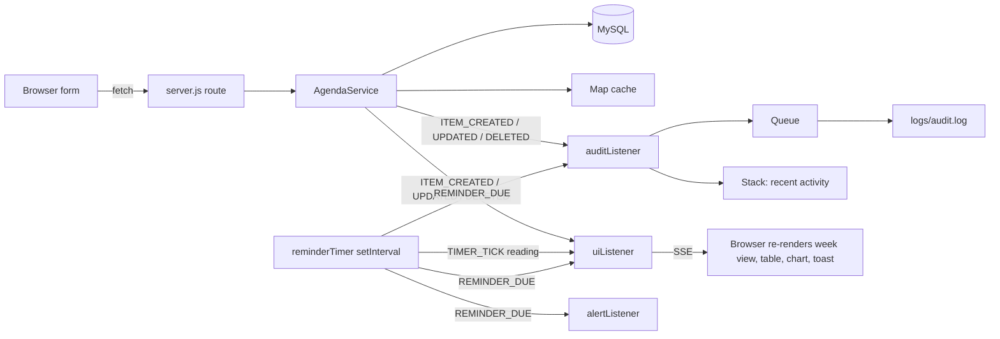

# Agenda

An interactive, event-driven web agenda to schedule everyday events (meetings and reminders), built with Node.js following Event-Oriented Programming (POE IH050).

## Team

- Gonzalez Nunez Isai
- Zuniga De Leon Bryan

Course: *Programación Orientada a Eventos* (IH050), 3rd semester, Computer Science, Universidad de Guadalajara (CUT).

## Features

- Create, view, edit and delete two kinds of items:
  - **Meeting**: title, date/time, duration (minutes), location, description.
  - **Reminder**: title, date/time, minutes before, description. It fires a real-time alert when `now >= date - minutesBefore`.
- Live dashboard (no page reloads). The main panel is a **week view** drawn on a canvas: one row per day (Mon to Sun), meetings as bars with their title, reminders as diamonds, today's row highlighted with a red "Now" line. Below it: the items table, a canvas bar chart (items per day, next 7 days) with counters, and the recent activity. Pop-up alerts for reminders.
- The form opens in a modal dialog ("+ New item" button, or "Edit" in the table).
- Times without seconds (`10:41 PM`) and durations as `HH:MM hrs` (`02:00 hrs`) on the whole page.
- Server timer that generates a **reading** every 10 seconds; each reading moves the "Now" line and updates the "Next" line.
- Data stored in MySQL; every action written to `logs/audit.log`.
- Works in several browser tabs at the same time (Server-Sent Events).
- Keyboard shortcuts: `Ctrl/Cmd + S` saves the open dialog, `Esc` closes it.

## Live demo script

What the teacher asked to see, and where it appears on screen:

| Teacher asks for | How the Agenda shows it |
|---|---|
| Dashboard web / GUI running | `npm run dev` → http://localhost:3000 with the full dashboard |
| Generation of readings ("lecturas") | Every 10 s the server timer (Event 01) builds a **reading** and emits `TIMER_TICK`. In the week view (main panel) the red "Now" line moves on today's row and the line under it changes: `Next: <title> in <HH:MM> hrs · Updated <h:mm AM/PM> by the server timer (Event 01)`. |
| CRUD persistence | Create with "+ New item", edit with "Edit" (same dialog), delete from the table; data is in MySQL and survives a server restart. |
| Tables / charts rendering | The week view, the items table, the 7-day chart and the counters re-render automatically after every CRUD event and every reading. |

Follow these steps in order during the presentation:

1. **Dashboard running** – run `npm run dev` and open http://localhost:3000. The console prints `Server ready at http://localhost:3000` and `logs/audit.log` gets a `server:ready` line.
2. **Generation of readings** – wait 10 seconds without touching anything: under the week view the "Updated" time changes, the "Next" line recalculates the time left (`HH:MM hrs`) and the red "Now" line on today's row moves to the server time. Meetings are bars with their title (start → end), reminders are diamonds with their title.
3. **CRUD persistence**
   - Click **+ New item**: the form opens in a dialog. Create a meeting for later today (with a duration) and save with `Ctrl/Cmd + S`; create a reminder too. Both appear in the table **and** in the week view, and the dialog closes by itself.
   - Edit one item (**Edit** opens the same dialog with its data) and delete another (**Delete**).
   - Stop the server with `Ctrl + C` (clean shutdown messages) and start it again: all items are still there because they live in MySQL.
4. **Tables / charts rendering** – open a second tab: after each create/edit/delete, both tabs re-render the week view, the table, the 7-day chart, the counters and the recent activity automatically.
5. **Threshold alert** – create a reminder 3 minutes ahead with "Alert minutes before" = 5. Within ~10 s a pop-up appears (only once) and the server console prints `[ALERT] ...`.
6. **Errors** – save with an empty title: a clear red message appears and the server keeps running.
7. **GUI events** – hover a bar or diamond in the week view (tooltip with title, start–end time and location or alert), hover the 7-day chart (tooltip), hover a table row (details bar), click inside the form of the dialog (blue highlight), press `Esc` (closes the dialog and clears the form).

## Tech stack

| Layer | Technology |
|---|---|
| Runtime | Node.js 20+ with ES Modules |
| Web server | Express 5 |
| Database | MySQL (or MariaDB) with `mysql2/promise` |
| Configuration | `dotenv` |
| Real time | Server-Sent Events (native `EventSource`) |
| Frontend | Plain HTML, CSS and JavaScript (browser ES modules) |
| Charts | Hand-drawn `<canvas>` (week view and 7-day bar chart) |
| Background work | `worker_threads` |

## Architecture

```
Agenda/
├── database/schema.sql          # database, table and sample rows (4 of them today)
├── logs/                        # audit.log is written here
├── public/                      # the dashboard (HTML, CSS, JS)
│   ├── index.html
│   ├── css/styles.css
│   └── js/
│       ├── app.js               # DOM events, fetch, SSE
│       ├── chart.js             # 7-day canvas chart + mouse tooltip
│       ├── timeline.js          # week view (canvas) + mouse tooltip
│       └── format.js            # clock times and HH:MM durations
└── src/
    ├── server.js                # Express API, SSE, startup, shutdown, errors
    ├── config/                  # constants.js (event names), database.js (pool)
    ├── models/                  # AgendaItem (abstract), Meeting, Reminder
    ├── collections/             # Queue and Stack
    ├── events/                  # AppEventEmitter (singleton), reminderTimer, listeners/
    ├── services/                # AgendaService (CRUD + Map cache)
    ├── workers/                 # StatsWorker (worker thread)
    └── utils/                   # Serializer, FileManager, dateUtils
```

Event flow:



## Rubric mapping

| Rubric criterion | Where it is covered |
|---|---|
| Object-oriented programming (POO) | `src/models/AgendaItem.js`, `Meeting.js`, `Reminder.js` (polymorphic `isDue()` and `getEndDate()`), `src/utils/Serializer.js` (factory) |
| Event architecture (POE) | `src/events/AppEventEmitter.js`, `src/events/reminderTimer.js`, `src/events/listeners/*`, `src/config/constants.js` |
| Persistence (MySQL + files) | `database/schema.sql`, `src/config/database.js`, `src/services/AgendaService.js`, `src/utils/FileManager.js` |
| Data structures (Map, Set, Queue, Stack) | `src/collections/DataStructures.js`, `AgendaService.js` (Map), `reminderTimer.js` and `uiListener.js` (Set), `auditListener.js` (Queue, Stack) |
| Error handling | `src/server.js` (try/catch in routes, error middleware, `uncaughtException`, `unhandledRejection`) |
| GUI / frontend | `public/index.html`, `public/css/styles.css`, `public/js/app.js`, `public/js/chart.js`, `public/js/timeline.js`, `public/js/format.js` |

## Event catalog

| # | Event | Where |
|---|---|---|
| 01 | Timer / Polling | `reminderTimer.js` `setInterval` → `TIMER_TICK` (reading: moves the "Now" line and updates "Next" in the week view) + `REMINDER_DUE` |
| 02 | System Load | `server.js` `startServer()` → `SERVER_READY`; browser `DOMContentLoaded` |
| 03 | Keyboard hotkeys | `app.js`: `Ctrl/Cmd + S` saves the form while the dialog is open, `Escape` closes the dialog |
| 04 | Mouse tracking | `timeline.js` and `chart.js`: `mousemove` on the canvas → tooltip; `mouseover` on table rows → details bar |
| 05 | Focus / Blur | `app.js`: `focusin` / `focusout` highlight the form inside the dialog; `visibilitychange` reloads data |
| 06 | Destroy / Cleanup | `server.js` `SIGINT` → `APP_SHUTDOWN`, stop timer, close SSE clients, close DB pool |
| 08 | Custom threshold alert | `REMINDER_DUE` (time left <= `minutesBefore`), `Reminder.isDue()` |
| 09 | Unhandled exception | `process.on('uncaughtException')` and `'unhandledRejection'` → `APP_ERROR` → audit |
| 10 | CRUD Data Change | `AgendaService` emits `ITEM_CREATED` / `ITEM_UPDATED` / `ITEM_DELETED` after MySQL succeeds; the browser redraws the table and the week view |
| 11 | GUI render | `uiListener` → SSE → `app.js` re-renders the week view, table, chart, counters and activity |
| 12 | Worker message | `StatsWorker` `postMessage` → service resolves the stats → `STATS_READY` |

Events with **multiple handlers**: `ITEM_CREATED` → audit + ui; `REMINDER_DUE` → alert + audit + ui.

## Individual events

- **Bryan – Event 01 (Timer / Polling)**: `src/events/reminderTimer.js`. A `setInterval` runs every 10 s. Each tick builds a *reading* with `createReading(items, now)` and emits `TIMER_TICK`; then it calls `item.isDue(now)` on every item (polymorphism) and emits `REMINDER_DUE` once per reminder, using a `Set` of already-notified ids. In the browser, `renderReading()` in `app.js` receives each reading and redraws the week view (`drawTimeline(canvas, items, now)` in `timeline.js`) with the server time, so the "Now" line on today's row moves by itself.
- **Isai – Event 10 (CRUD Data Change)**: `src/services/AgendaService.js`. `create`, `update` and `remove` first write to MySQL, then update the `Map` cache and only then emit `ITEM_CREATED`, `ITEM_UPDATED` or `ITEM_DELETED`. The service does not know who listens: the audit log and the browser react on their own.

## Design decisions

| Decision | Alternatives considered | Why we chose it |
|---|---|---|
| Express + vanilla JS | NestJS, React | Fewer layers to learn; every line is ours and we can explain it. |
| ES Modules | CommonJS (`require`) | Required by the rubric and the modern standard. |
| Singleton `EventEmitter` | One emitter per module | One central bus; modules stay decoupled (publishers never import subscribers). |
| One `agenda_items` table with a `type` column | One table per class | Simpler queries and one sorted list for the dashboard. |
| `mysql2` with raw SQL | ORM (Sequelize, Prisma) | We see and control the SQL; `?` placeholders prevent SQL injection. |
| `Map` cache in the service | Query MySQL every time | Fast lookups by id; the timer does not query the database every 10 s. |
| Server-Sent Events | WebSockets / Socket.io, polling | We only need server → browser; SSE is native in Node and the browser, no library. |
| Hand-made canvas charts (timeline and bars) | Chart.js, a calendar library | Works offline in class and shows our own mouse events. |
| `getEndDate()` in the models | Computing the end time in the browser | Polymorphism: `AgendaItem` returns the start date, `Meeting` overrides it with start + `durationMinutes`; `toJSON()` sends `endDate` so the browser only draws. |
| Worker thread for statistics | Compute in the main thread | Heavy work leaves the main event loop free. |
| `Queue`, `Stack`, `Set` | Plain arrays | Queue: log lines are written one by one, in order. Stack: newest activity first (max 10). Set: a reminder alerts only once, and each SSE client is stored once. |

## Installation

1. Install **Node.js 20+** and **MySQL** (on macOS: `brew install mysql` and `brew services start mysql`; MariaDB also works).
2. Install the dependencies:
   ```bash
   npm install
   ```
3. Create a MySQL user for the app (example):
   ```sql
   CREATE USER 'agenda_user'@'localhost' IDENTIFIED BY 'your_password';
   GRANT ALL PRIVILEGES ON agenda_db.* TO 'agenda_user'@'localhost';
   ```
4. Copy `.env.example` to `.env` and fill in your credentials:
   ```bash
   cp .env.example .env
   ```
5. Create the database, the table and the sample data (this also **resets** the table; run it again on the demo day so the sample items are "today"):
   ```bash
   mysql -u root -p < database/schema.sql
   ```
6. Start the app and open http://localhost:3000:
   ```bash
   npm run dev     # restarts automatically when a file changes
   npm start       # normal mode
   ```

If MySQL is not reachable, the server prints `Cannot connect to MySQL. Check your .env file.` and exits.

## API endpoints

| Method | Route | Action | Success |
|---|---|---|---|
| GET | `/api/items` | List all items (sorted by date) | 200 |
| GET | `/api/items/:id` | Get one item | 200 |
| POST | `/api/items` | Create an item | 201 |
| PUT | `/api/items/:id` | Update an item | 200 |
| DELETE | `/api/items/:id` | Delete an item | 204 |
| GET | `/api/stats` | Statistics from the worker thread | 200 |
| GET | `/api/activity` | Recent activity (Stack, newest first) | 200 |
| GET | `/api/events` | Server-Sent Events stream | 200 |

Errors always return JSON: `{ "error": "message" }` with status 400 (invalid data), 404 (not found) or 500 (server/database error).

Example bodies for `POST /api/items` (`durationMinutes` is optional, default 60):

```json
{ "type": "meeting", "title": "Data Structures class", "date": "2026-11-25T15:00", "durationMinutes": 120, "location": "CUT building B", "description": "" }
{ "type": "reminder", "title": "Submit homework", "date": "2026-11-25T18:00", "minutesBefore": 30, "description": "Upload the PDF" }
```

Every item in the responses also has `endDate` (same format as `date`).

## Project structure

| File | Purpose |
|---|---|
| `src/server.js` | Express app, REST API, SSE endpoint, startup, shutdown, global errors |
| `src/config/constants.js` | Event names, item types, timer interval |
| `src/config/database.js` | MySQL pool, `testConnection()`, `closePool()` |
| `src/models/AgendaItem.js` | Abstract base class (private fields, validation, `getEndDate`, `toJSON`) |
| `src/models/Meeting.js` | Meeting (adds `location` and `durationMinutes`, overrides `getEndDate`) |
| `src/models/Reminder.js` | Reminder (adds `minutesBefore`, overrides `isDue`) |
| `src/collections/DataStructures.js` | `Queue` and `Stack` |
| `src/events/AppEventEmitter.js` | The singleton event bus |
| `src/events/reminderTimer.js` | Event 01: readings and reminder checks |
| `src/events/listeners/auditListener.js` | Writes `logs/audit.log`, keeps recent activity |
| `src/events/listeners/alertListener.js` | Console alert for due reminders |
| `src/events/listeners/uiListener.js` | Sends events to the browser through SSE |
| `src/services/AgendaService.js` | CRUD + `Map` cache + CRUD events |
| `src/workers/StatsWorker.js` | Statistics in a worker thread |
| `src/utils/Serializer.js` | DB row ↔ object ↔ JSON, `createItem()` factory |
| `src/utils/FileManager.js` | Async append to files |
| `src/utils/dateUtils.js` | `toLocalDateString()` for `datetime-local` inputs |
| `public/js/app.js` | Dashboard logic (DOM, fetch, SSE, hotkeys, focus) |
| `public/js/chart.js` | 7-day canvas chart and tooltip |
| `public/js/timeline.js` | Week view (canvas, one row per day) and tooltip |
| `public/js/format.js` | `formatClock()`, `formatDate()`, `formatDuration()` (`HH:MM hrs`) |
